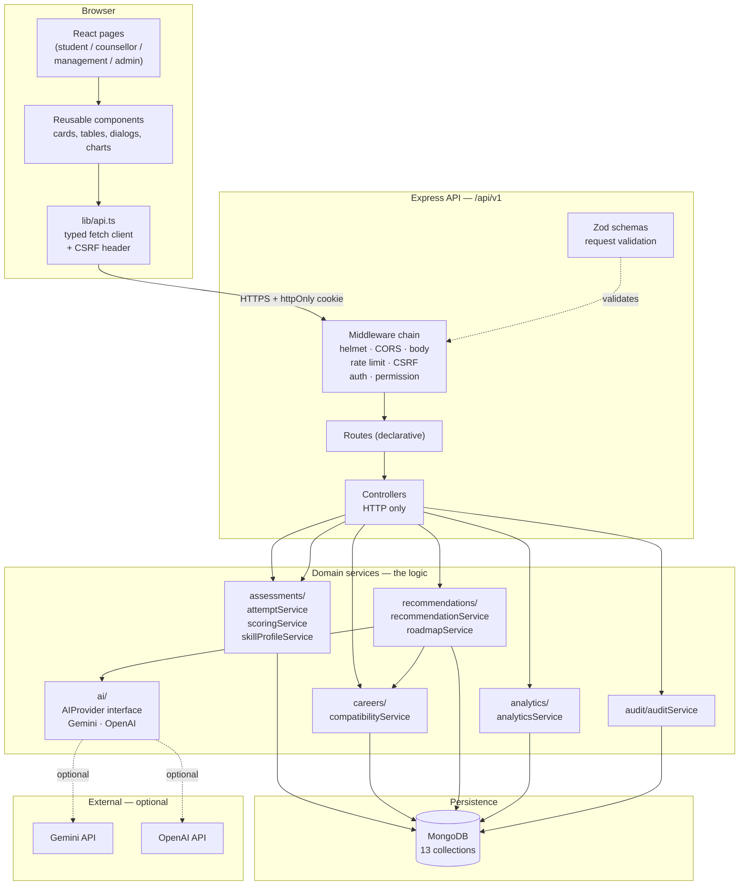
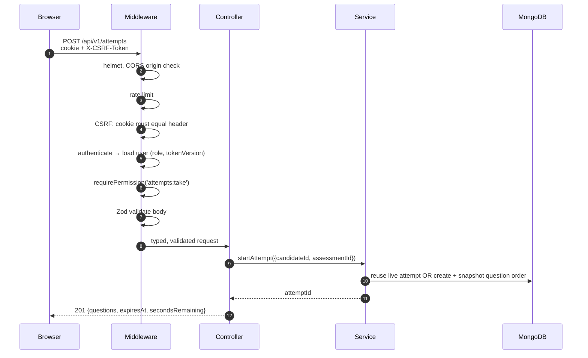
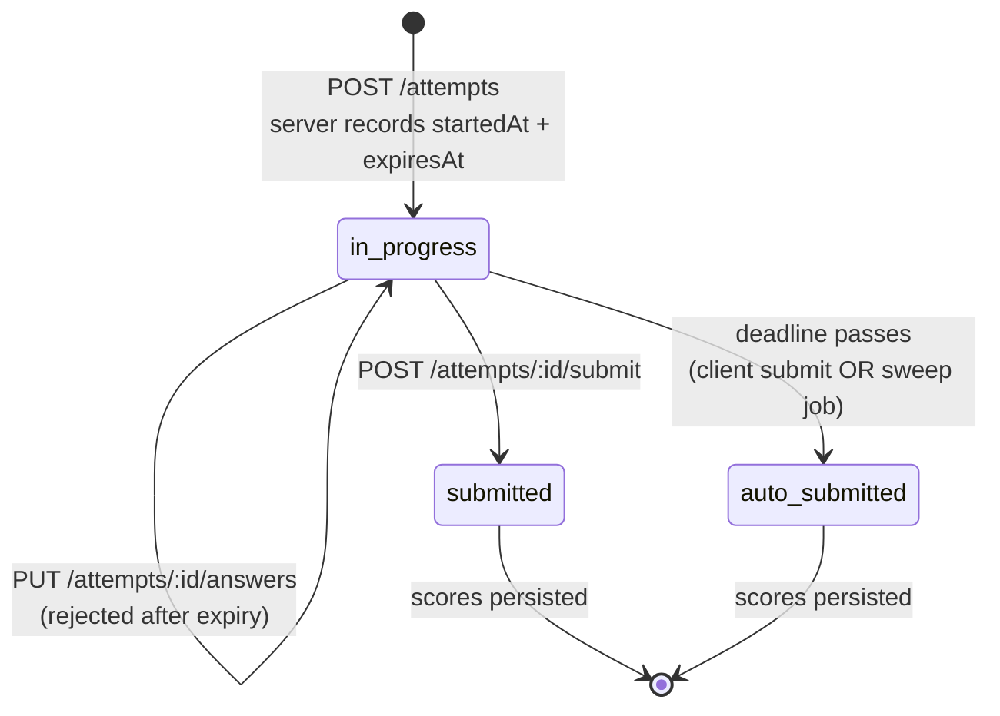
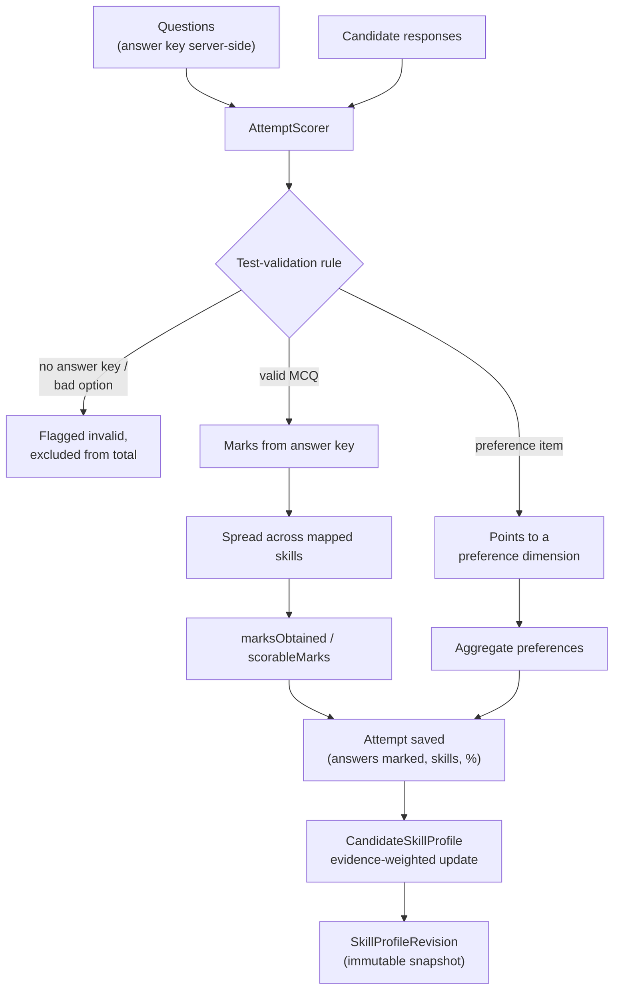
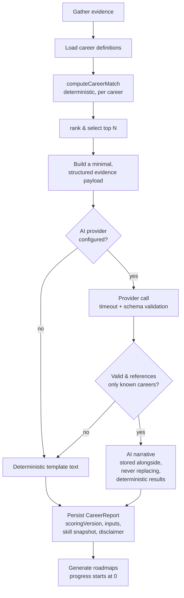

# Architecture

How the system is put together, and why.

---

## 1. Layering



**Rule enforced throughout:** controllers never contain business logic, and services never touch
`req`/`res`. Every score, gap and report is produced by a service function that can be unit-tested
without HTTP.

---

## 2. Why this stack

| Choice | Reason |
|---|---|
| TypeScript end to end | The scoring algorithm has many interacting numeric rules; types catch a whole class of mistakes at compile time. |
| Controllers → services split | Scoring and matching are the parts worth testing and explaining in a viva. Isolating them makes both trivial. |
| Deterministic scoring, AI for prose only | A language model must never decide a number or a ranking. This is the project's central design decision. |
| Server-authoritative timing | A browser countdown can be edited. Recording `expiresAt` server-side makes the rule enforceable. |
| Cookie session + double-submit CSRF | Keeps the token out of JavaScript while still allowing the SPA to call the API. |
| Mongoose | Schema validation and indexes are the main defence against malformed data entering an assessment pipeline. |

---

## 3. Request lifecycle



Authorisation happens **three times**, deliberately:

1. `authenticate` loads the user fresh from the database on every request, so a role change or
   deactivation takes effect immediately rather than when the token expires.
2. `requirePermission` checks the server-side permission matrix.
3. The controller/service re-checks resource ownership (`candidate` field), so even a user with the
   right role cannot reach another candidate's record.

The frontend hides buttons for usability only. Removing a button changes nothing about access.

---

## 4. Assessment attempt lifecycle



Key properties, each covered by a test:

| Property | How it is guaranteed |
|---|---|
| Refresh does not extend time | A second `POST /attempts` returns the **existing** live attempt; the timer is never re-derived from the client. |
| Browser clock cannot help | The client anchors its countdown to the `serverTime` returned by the API; the server re-checks `expiresAt` on every save and submit. |
| Timer works without the browser | `jobs/attemptSweep.ts` runs on start-up and every 60 s, finalising anything past its deadline. |
| No double submission | The attempt is claimed with an atomic `findOneAndUpdate({status:'in_progress'})`. A second submit finds nothing to claim and returns the existing result. |
| No post-submission edits | Saving answers checks final status and returns `409`. |
| One live attempt | A partial unique index enforces it at the database level. |

---

## 5. Scoring pipeline



### Test-validation rule

An item is **scorable** when it is an MCQ with ≥ 2 options, a matching answer key and marks > 0, or a
preference item with a declared dimension. Anything else is **flagged and excluded** — the scorer
never invents an answer to keep a number looking tidy. The reduced denominator is reported to the
client as `scorableMarks` so a score of 100% over a single surviving item is never presented as if
it covered the whole test.

### Objective scoring

```
percentage = marksObtained / scorableMarks × 100
```

Unanswered items stay in the denominator. No negative marking, no guessing penalty — documented
rather than implied.

### Preference scoring

Each response contributes points to a declared dimension. The observed points are mapped onto 0–100
where **50 means "no preference expressed"**. These are labelled *indicative working preferences*
everywhere in the product and are never described as personality types, traits or diagnoses.

### Skill profile update

```
newLevel = (oldLevel × oldEvidence + observation × newEvidence)
           / (oldEvidence + newEvidence)
```

`newEvidence` is the number of marks that produced the measurement, so longer tests count for more but
never erase earlier evidence. Every update writes an immutable `SkillProfileRevision`, so progression
is reconstructable and history is never overwritten.

---

## 6. Career compatibility algorithm — version `compatibility-v1.0.0`

Implemented in `services/careers/compatibilityService.ts`. It is deterministic, side-effect free,
and directly unit-tested.

### Inputs

For each career requirement `r = (skill, requiredLevel, weight, importance)`:
`measured(r)` — the 0–100 skill level, and `evidence(r)` — the amount of assessment evidence behind it.

### Step 1 — Evidence damping

```
confidence = evidence / (evidence + 2)      capped at 1
effective  = measured × (0.7 + 0.3 × confidence)
```

A measurement from very little evidence is trusted a little less. It is **never discarded and never
treated as zero**.

### Step 2 — Requirement ratio

```
ratio = min(1, effective / requiredLevel)
```

### Step 3 — Weighted skill fit with an explicit coverage penalty

```
dataCoverage = Σ weight(measured r) / Σ weight(all r)
skillFitRaw  = Σ (weight × ratio) / Σ weight
skillFit     = skillFitRaw × (0.40 + 0.60 × dataCoverage)
```

Unmeasured requirements reduce the score, but the penalty is bounded — so *"not yet assessed"* is
reported as **unknown** rather than as low competence.

### Step 4/5 — Aptitude and preference fit

Weighted means over the dimensions the career declares, only where evidence exists. If a career
declares no such dimension, that component is omitted and the remaining weights are re-normalised
rather than counted as zero.

### Step 6 — Final score

```
compatibility = 100 × (0.70 × skillFit + 0.20 × aptitudeFit + 0.10 × preferenceFit)
```

with weights re-normalised when a component is absent.

### Confidence and minimum data

| `dataCoverage` | Confidence |
|---|---|
| ≥ 0.70 | good |
| ≥ 0.40 | moderate |
| < 0.40 | low |

Fewer than one completed assessment, or coverage below 0.15, marks the result as *insufficient
evidence for a strong recommendation*.

Every requirement appears in the output with its required level, effective measured level, weight,
gap and a written note — so the number is always traceable.

---

## 7. Report generation and the AI layer



Design rules that fall out of this diagram:

- Scores, rankings and gaps are computed **before** any AI call and stored **separately** from the
  narrative. A model failure cannot corrupt a score.
- The provider receives only already-verified evidence and is instructed never to invent figures.
- The response is parsed defensively (JSON may be fenced or embedded) and validated with Zod.
  Unknown career references are stripped **twice** — in the provider wrapper and again in the report
  service — so the invariant holds regardless of which generator is used. A narrative with no
  surviving reference is discarded entirely and the reason recorded.
- When nothing usable comes back, the report still generates from templates and the UI says
  **"Deterministic"** rather than pretending an AI call happened.
- Roadmaps always start at `not_started` / 0 %. Only a candidate action changes progress.

---

## 8. Role-based access control

`config/constants.ts` holds the single permission matrix; `config/permissions.ts` exposes it to the
API. The admin UI renders it from `GET /users/permissions`, so the interface cannot drift from the
server.

| Area | admin | counsellor | management | student |
|---|:--:|:--:|:--:|:--:|
| User administration | ✔ full | — (assigned only) | read-only | — |
| Question bank | ✔ full | create/edit | read | — |
| Test sets | ✔ full | create/edit | read | read published |
| Career & skill catalogue | ✔ full | read | read | read |
| Take assessments | — | — | — | ✔ |
| Own reports / roadmaps | ✔ | read assigned | — | ✔ |
| Student-level analytics | ✔ | assigned only | ✖ blocked | own only |
| Institutional aggregates | ✔ | — | ✔ | — |
| System settings / AI config | ✔ | — | — | — |
| Audit log | ✔ | — | — | — |

Two deliberate rules worth stating in a viva:

1. **Management is read-only.** It has no write permission anywhere. Individual candidate records are
   blocked at the controller, not merely filtered out of a list.
2. **Counsellors are scoped, not privileged.** They can only reach candidates whose
   `assignedCounsellor` equals their own id — enforced inside the query, not by the UI.

---

## 9. Analytics

`analyticsService.ts` produces role-specific payloads. When a dataset is empty it returns an explicit
`isEmpty` flag rather than zeros that could be read as measurements. No endpoint returns percentile
ranks or cross-candidate comparisons.

---

## 10. Background work

| Job | Trigger | Purpose |
|---|---|---|
| Attempt sweep | start-up + every 60 s | Finalise attempts past their deadline, so the system is correct even if every browser closes. |

Each call is idempotent: the attempt is claimed atomically, so a sweep racing a manual submit cannot
double-score.

---

## 11. Error handling

A single `ApiError` class carries an HTTP status, a stable machine `code` and optional field-level
details. The central error handler converts it into the standard response envelope, maps Mongoose
`ValidationError` / `CastError` / duplicate-key errors to sensible statuses, redacts internal detail
in production, and never leaks a stack trace to the client. The logger redacts password/token/API-key
keys and truncates long values, so request logs can never contain credentials.

---

## 12. Technology choices and trade-offs

| Decision | Alternative not taken | Why |
|---|---|---|
| Server-computed scores | Client-side scoring | A browser can be modified; authoritative scores must not be. |
| Versioned deterministic scoring | "Let the model decide the match" | Reproducibility and explainability for a viva; the model cannot be audited. |
| httpOnly cookie session | JWT in `localStorage` | Removes token exfiltration via XSS entirely. |
| Double-submit CSRF token | Nothing | Cookie auth needs CSRF defence; this needs no extra round trip. |
| Partial unique index for live attempts | Application check only | The database enforces the invariant even under concurrency. |
| Immutable profile revisions | Overwrite latest | Requirement to track progression; also enables "compare with previous". |
| Own fetch client | Axios | Typed responses, no extra dependency, CSRF handled in one place. |

---

## 13. Known limitations

Stated plainly so they are visible rather than discovered later:

- The assessment bank and career catalogue are **sample data** created for this project. They are
  illustrative, not validated against industry standards or a representative population.
- The compatibility algorithm is **unvalidated psychometrically**. It has not been tested against
  real career outcomes, and no such claim is made.
- There is **no proctoring**. Timed tests over an unsupervised network are not equivalent to a
  supervised exam.
- Single-database design; no caching layer, message queue or horizontal scaling. Adequate for an
  academic deployment, not for a large institution.
- The AI narrative is English-only and requires a paid provider key to demonstrate. The deterministic
  path is fully functional and is what the demo usually shows.
