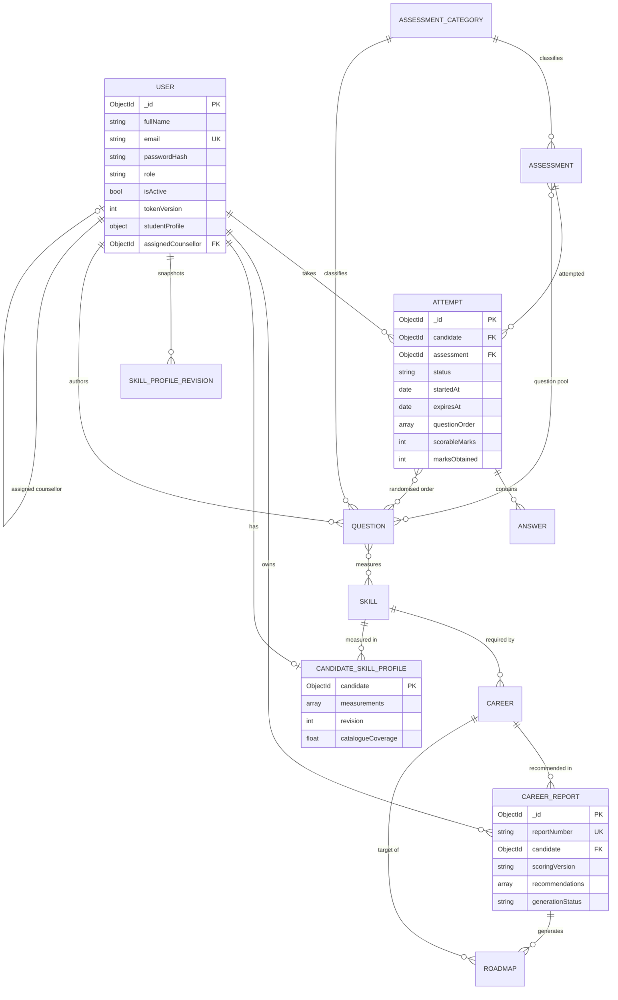

# Database Design

MongoDB (Mongoose). Thirteen collections, separated by responsibility rather than one large
document store.

---

## 1. Entity relationships



---

## 2. Collections

### `users`

| Field | Type | Notes |
|---|---|---|
| `fullName` | String | required, 2–120 |
| `email` | String | **unique**, lowercase, indexed |
| `passwordHash` | String | bcrypt, **`select: false`** — never loaded by default |
| `role` | String | `admin` \| `counsellor` \| `management` \| `student` |
| `isActive` | Boolean | deactivation blocks sign-in immediately |
| `tokenVersion` | Number | incremented to revoke all sessions |
| `studentProfile` | Embedded | institution, department, yearOfStudy, batch, rollNumber, objective, `completionPercent` |
| `assignedCounsellor` | ObjectId → User | scopes counsellor access |
| `lastLoginAt`, `loginCount`, `failedLoginCount`, `lockedUntil` | — | brute-force protection |
| `mustChangePassword` | Boolean | set when an admin issues a temporary password |
| `resetTokenHash`, `resetTokenExpiresAt` | String/Date | `select: false`, SHA-256 hashed |
| `notes` | String | admin notes |

Indexes: `email` (unique), `role + isActive`, `assignedCounsellor`, text on `fullName`, `email`.

`completionPercent` is recomputed in a `pre('save')` hook from which academic fields are filled — it
is derived, never client-supplied.

---

### `skills` — the measurement vocabulary

| Field | Type | Notes |
|---|---|---|
| `code` | String | **unique**, uppercase — the stable join key across questions and careers |
| `name` | String | **unique** |
| `category` | String | `aptitude` \| `technical` \| `domain` \| `professional` \| `communication` |
| `isPreferenceSkill` | Boolean | derived from the personality instrument |
| `description`, `tags`, `isActive`, `isSample` | | |

Seeded with 28 skills. This catalogue is what makes scores comparable: a question measures a skill
*code*, and a career requires a skill *code*.

---

### `questions`

| Field | Type | Notes |
|---|---|---|
| `text` | String | required |
| `category` | Enum | one of the five |
| `topic` | String | sub-topic, indexed |
| `questionType` | Enum | `mcq` \| `likert` |
| `options[]` | `{ optionId, text, preferencePoints? }` | `preferencePoints` only for preference items |
| `correctOptionId` | String | **server-side only** — never sent to a candidate before submission |
| `preferenceDimension` | Enum | required for `likert` |
| `scaleMin`, `scaleMax` | Number | advertised scale bounds |
| `explanation` | String | shown in the review after submission |
| `difficulty` | Enum | `easy` \| `medium` \| `hard` |
| `skillMappings[]` | `{ skill, weight }` | what the item measures; weights normalised at scoring time |
| `marks`, `isActive`, `isSample`, `usageCount`, `author` | | |

Indexes: `category + isActive + difficulty`, text on `text` and `topic`, `skillMappings.skill`.

**Scorability is a rule, not a flag.** `evaluateQuestionScorability()` is applied when a test set is
saved and again at scoring time, so a broken item is always caught.

---

### `assessments` — test sets

| Field | Notes |
|---|---|
| `title`, `description`, `instructions` | candidate-facing copy |
| `category` | must match the pool's questions |
| `questionPool[]` | ObjectIds of questions |
| `questionCount` | must be ≤ pool size |
| `durationMinutes` | becomes `expiresAt` when an attempt starts |
| `marksPerQuestion`, `totalMarks`, `passingPercentage` | scoring configuration |
| `shuffleQuestions`, `shuffleOptions`, `shuffleAtAttempt` | randomisation flags |
| `maxAttempts` | enforced server-side |
| `status` | `draft` \| `published` \| `archived` |
| `availableFrom`, `availableUntil`, `assignedBatches[]` | availability window |
| `scoringNote` | explains the scoring model on the instructions screen |
| `attemptCount` | denormalised counter for dashboards |

Indexes: `status + category`, `questionPool`, text on `title`.

---

### `assessmentcategories`

`key` (unique enum), `name`, `description`, `colour`, `icon`, `scoringModel` (`objective` |
`preference`), `displayOrder`, `isActive`.

---

### `attempts`

| Field | Notes |
|---|---|
| `candidate`, `assessment` | references |
| `status` | `in_progress` \| `submitted` \| `auto_submitted` \| `expired` |
| `startedAt`, `expiresAt` | **server-authoritative clock** |
| `submittedAt`, `evaluatedAt`, `submissionReason` | `manual` \| `time_expired` \| `admin` |
| `questionOrder[]` | randomised order snapshot, fixed for the attempt's life |
| `optionOrders` | Map questionId → randomised option ids |
| `marksObtained`, `scorableMarks`, `totalMarks`, `percentage`, `passed` | result |
| `answeredCount`, `flaggedCount`, `timeSpentSeconds` | |
| `invalidQuestionIds[]` | items excluded by the test-validation rule |
| `skillResults[]` | per-skill marks, score and evidence for this attempt |
| `preferenceResults[]` | per-dimension points and normalised score |
| `personalityResponses[]` | dimension + choice, evidence for preference results |
| `ipAddress`, `userAgent` | provenance |

Indexes:

- `candidate + assessment + status`
- `candidate + createdAt desc`
- `status + expiresAt` (drives the sweep job)
- **partial unique** `{ candidate, assessment }` where `status: 'in_progress'` — the database
  guarantees at most one live attempt per candidate per test set, even under concurrency.

---

### `answers`

One document per question per attempt.

| Field | Notes |
|---|---|
| `attempt`, `question`, `candidate`, `assessment` | references |
| `displayIndex` | position in the randomised order |
| `selectedOptionId`, `responseText` | the candidate's response |
| `isAnswered`, `isFlagged`, `savedAt` | |
| `marksAwarded`, `marksPossible`, `isCorrect` | **computed server-side only** |
| `evaluationStatus` | `scored` \| `preference` \| `invalid` \| `unanswered` |
| `invalidReason` | why the item was excluded |
| `skillContributions[]` | `{ skill, marksObtained, marksPossible }` |
| `preferenceContribution` | `{ dimension, points, maxPoints }` |

Indexes: unique `{ attempt, displayIndex }`, unique `{ attempt, question }`, `candidate + createdAt`.

Answer documents are seeded at attempt creation, which is what makes a page refresh restore exactly
the same slots.

---

### `candidateskillprofiles` — the measured skill state

| Field | Notes |
|---|---|
| `candidate` | **unique** — one profile per candidate |
| `measurements[]` | `{ skill, skillCode, skillName, category, score, evidence, observations, lastUpdatedAt, history[] }` |
| `measurements[].history[]` | `{ attempt, assessment, assessmentTitle, score, gainedEvidence, at }`, capped at the last 20 |
| `revision` | incremented on every update |
| `catalogueCoverage` | measured skills ÷ active catalogue skills |
| `totalCompletedAssessments` | |

History is **bounded** at 20 entries per skill so a document cannot grow without limit, while still
supporting meaningful trend analysis.

---

### `skillprofilerevisions`

Immutable snapshot per revision: `{ candidate, revision, triggerAttempt, triggerAssessment, reason,
snapshot[], catalogueCoverage }`. Unique on `{ candidate, revision }`, written with an upsert so a
repeated update cannot corrupt history.

This is what allows "compare with your previous profile" without ever overwriting the past.

---

### `careers` — the catalogue

| Field | Notes |
|---|---|
| `slug`, `title` | **unique** |
| `category`, `description`, `responsibilities[]` | |
| `requiredSkills[]` | `{ skill, skillCode, skillName, requiredLevel (0–100), weight (0–1), importance (core/supporting), developmentFocus }` |
| `aptitudeFit[]` | `{ dimension, weight }` |
| `preferenceFit[]` | `{ dimension, weight }` |
| `prerequisites[]`, `learningStages[]`, `suggestedProjects[]`, `relatedCareers[]` | |
| `isActive`, `isSample`, `sourceNote` | |

`skillCode`/`skillName` are denormalised into the requirement for readable reports and so that a
historical report stays readable even if the skill is later renamed.

Indexes: `slug`/`title` unique, `category + isActive`, text on `title` and `description`.

---

### `careerreports`

| Field | Notes |
|---|---|
| `candidate`, `reportNumber` | unique human-readable id, e.g. `CGR-20260115-0001` |
| `scoringVersion` | e.g. `compatibility-v1.0.0` — makes results reproducible |
| `inputAttemptIds[]`, `inputAssessments[]` | exactly what fed this report |
| `skillProfileRevision` | which profile revision was used |
| `dataCoverage`, `completedAssessments` | confidence context |
| `skillSnapshot[]` | frozen copy of the profile at generation time |
| `strongestSkills[]`, `weakestSkills[]`, `unmeasuredSkillCodes[]` | |
| `recommendations[]` | per career: score, confidence, `evidence[]` (per-requirement), `deterministicSummary`, optional `aiExplanation`, `topGaps[]` |
| `preferenceProfile[]` | |
| `aiNarrative` | optional narrative — stored **separately** from the deterministic results |
| `generationStatus`, `aiProviderUsed`, `aiFailureReason`, `aiLatencyMs` | honest provenance |
| `disclaimer` | |

A report is a **snapshot**: it never changes when the candidate completes another assessment.

---

### `roadmaps`

| Field | Notes |
|---|---|
| `candidate`, `career`, `report` | unique on `{ candidate, career }` |
| `scoringVersion`, `title`, `summary` | |
| `currentDemonstratedSkills[]`, `priorityGaps[]` | |
| `items[]` | `{ order, title, description, skillCode, kind (learn/practice/project/milestone/assess), stage (beginner/intermediate/advanced), estimatedHours, completionCriteria, resourceLinks[], status, startedAt, completedAt }` |
| `milestones[]` | `{ stage, title, completionCriteria, itemIds[], completed, completedAt }` |
| `progressPercent` | recomputed from item statuses |
| `lastActivityAt`, `createdBy`, `isSample` | |

`resourceLinks` come from a small curated static library, never from model output. Items are created
as `not_started` — a roadmap is never born completed.

---

### `auditlogs`

`{ actor, actorEmail, actorRole, action, category, targetType, targetId, outcome, message, metadata,
ipAddress, userAgent, severity, createdAt }`.

`metadata` is filtered through a fixed key allow-list of primitive values, so raw answer payloads,
passwords and tokens can never be persisted. `category` and `severity` support the admin filters.

Indexes: `createdAt desc`, `actor + createdAt desc`, `category + severity + createdAt desc`.

---

### `systemsettings`

`{ key (unique), value, valueType, category, label, description, isSecretBacked, updatedBy }`.

Non-secret configuration only. **API keys, JWT secrets and database credentials are never stored
here** — they live in environment variables, and `GET /settings` reports only *whether* a key is
configured, never its value.

---

## 3. Design decisions

**Separated by responsibility, not one blob.** Answers are separate from attempts so a 200-question
attempt does not carry a 200-element embedded array; reports are separate so history survives.

**Natural keys on master data.** `skills.code`, `careers.slug` and `users.email` let the seed script
upsert idempotently — re-running it never creates duplicates.

**Denormalised where it buys readability.** `skillCode`/`skillName` inside career requirements and
inside a report snapshot mean a historical report stays readable without a join.

**Bounded growth.** Per-skill history is capped at 20 entries; reports store a snapshot rather than a
live reference.

**No unbounded collections.** All list endpoints paginate (`page`, `limit ≤ 100`).

---

## 4. Backup and recovery

```bash
# Logical backup of one database
mongodump --db career_guide --out ./backups/2026-01-15

# Restore
mongorestore --db career_guide ./backups/2026-01-15/career_guide

# Single collection
mongodump --db career_guide --collection attempts --out ./backups/attempts
mongorestore --db career_guide --collection attempts ./backups/attempts/attempts.bson

# Compressed
mongodump --db career_guide --gzip --archive=career_guide.archive.gz
mongorestore --gzip --archive=career_guide.archive.gz --db career_guide
```

**Recommendation for a live deployment:** enable MongoDB Atlas continuous backup, or for self-hosted
MongoDB configure replica-set backups with a documented retention window. Test a restore — an
unverified backup is not a backup.

---

## 5. Verifying the data

```javascript
// mongosh career_guide

// Collection sizes
db.getCollectionNames().map(n => ({ collection: n, documents: db[n].countDocuments() }))

// Unique indexes present
db.users.getIndexes().filter(i => i.unique)

// Confirm one live attempt per candidate per assessment
db.attempts.getIndexes().filter(i => i.name === 'one_live_attempt')

// Candidates with a skill profile
db.candidateskillprofiles.countDocuments({ "measurements.0": { $exists: true } })

// Reports by scoring version
db.careerreports.aggregate([{ $group: { _id: "$scoringVersion", count: { $sum: 1 } } }])

// Accounts that must never ship to production
db.users.find(
  { email: /@careerguide\.local$/ },
  { email: 1, role: 1 }
)
```

That last query is worth running before any deployment: it lists every seeded development account.
