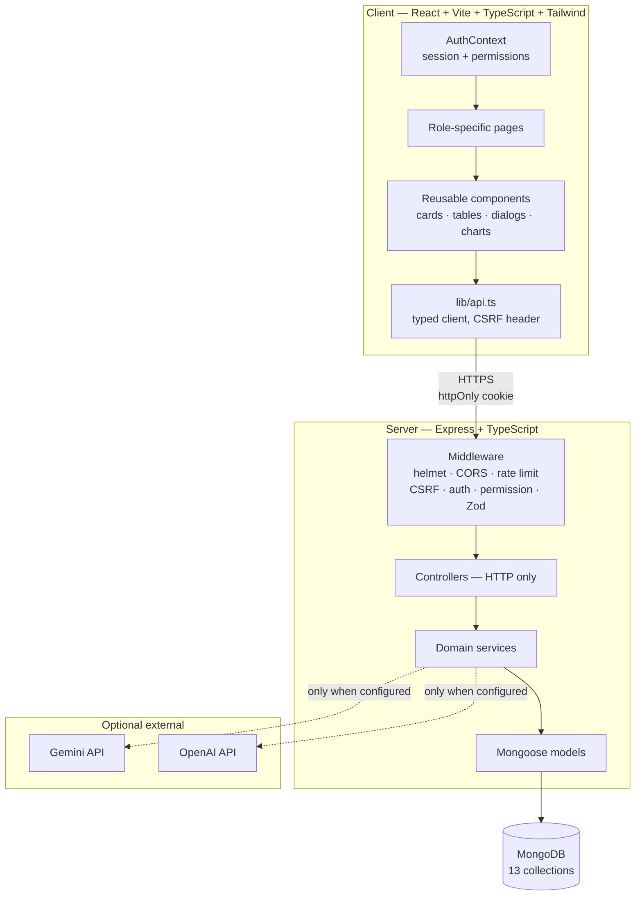
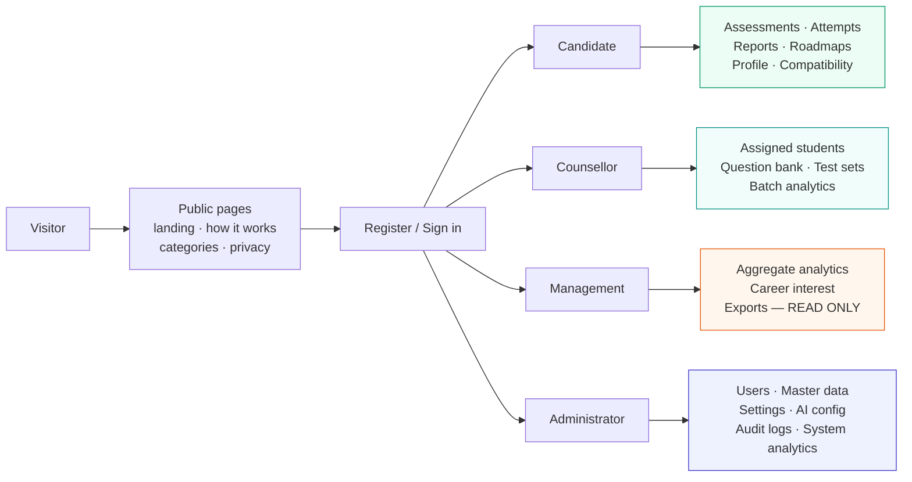
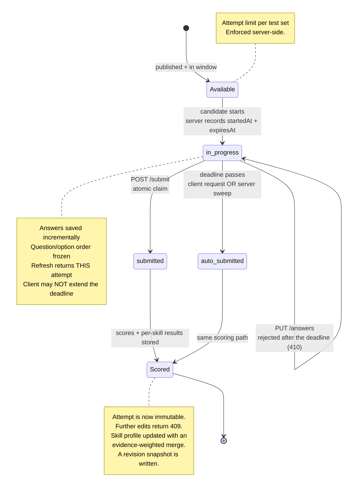
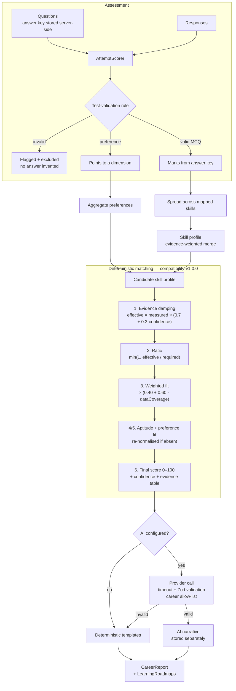
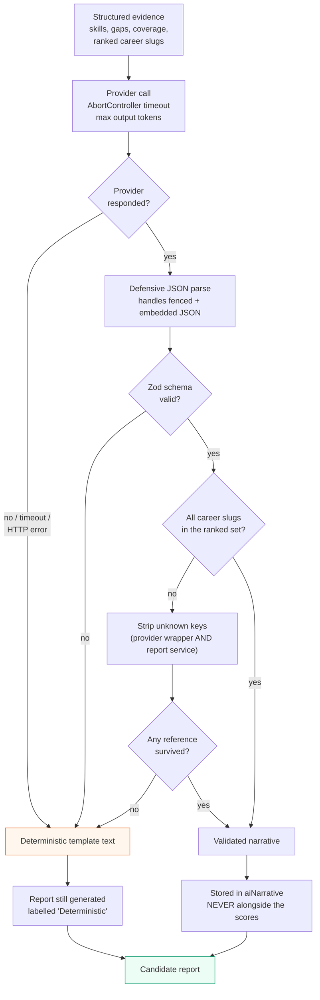
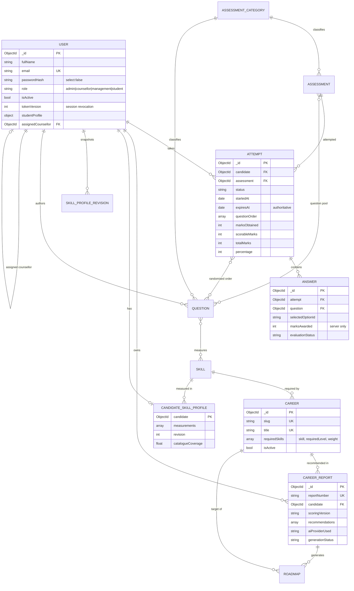
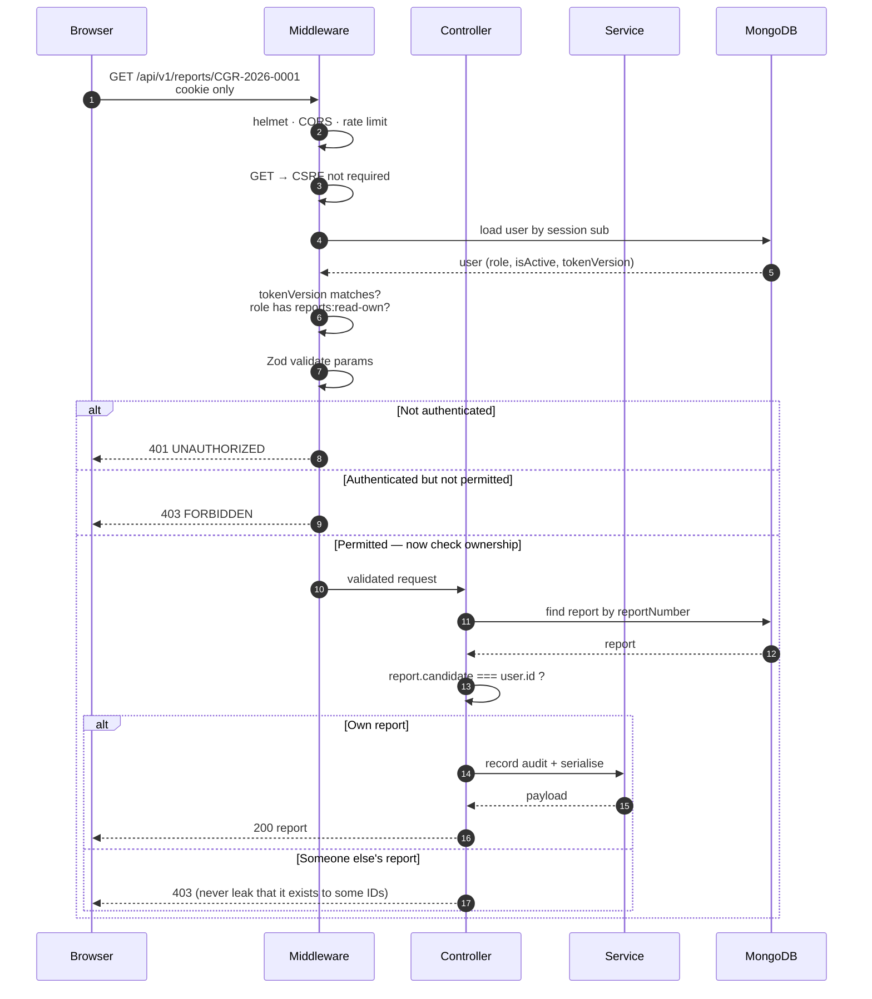
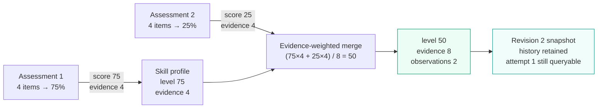
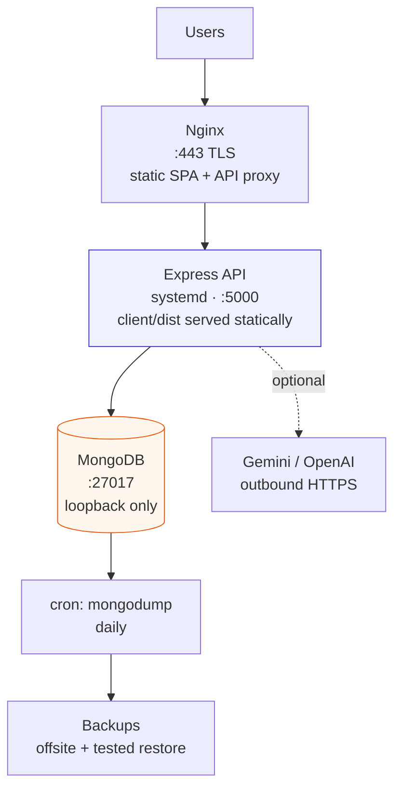

# Diagrams

Mermaid sources for the system architecture, data model and workflows. All render natively on GitHub
and in VS Code with the Markdown Preview Mermaid Support extension.

---

## 1. System architecture

---

## 2. Role workspaces and permission boundaries

**All four boundaries are enforced by the API**, not by hiding navigation. A request without the
required permission returns `403` regardless of what the interface shows.

---

## 3. Assessment attempt lifecycle

---

## 4. Scoring and recommendation pipeline

---

## 5. AI safety pipeline

**Invariant:** model output can never produce or alter a number, a rank or a permission decision.

---

## 6. Entity relationship diagram

---

## 7. Request authorisation sequence

Authorisation is checked **three times** — authentication, permission, ownership — because any one of
them alone is insufficient.

---

## 8. Skill profile evolution

A single short test never erases a well-evidenced earlier result, and history is never overwritten.

---

## 9. Deployment topology

Single-origin serving keeps the session cookie first-party, so `SameSite=Lax` works and no CORS
relaxation is required.
