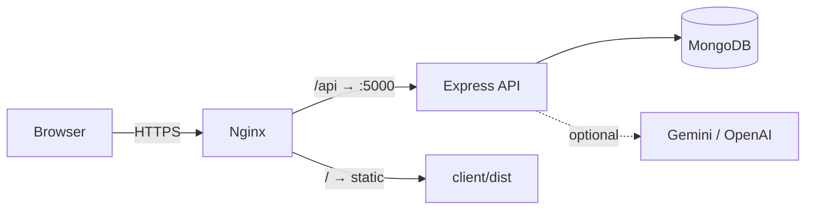

# System Requirements

## Hardware

| Component | Minimum | Recommended |
|---|---|---|
| CPU | 2 cores | 4 cores |
| RAM | 2 GB | 4 GB |
| Disk | 5 GB free | 20 GB (logs, backups, MongoDB) |
| Network | Broadband | Broadband, HTTPS |

The application is not compute-intensive. Bottlenecks would be MongoDB I/O and network latency, not
CPU.

## Software

### Required

| Software | Version | Verified on |
|---|---|---|
| Node.js | ≥ 20.19 (LTS) | v24.11.1 |
| npm | ≥ 10 | 11.6.2 |
| MongoDB | ≥ 6.0 | 8.x |
| Git | any recent | 2.56.0 |

### Optional

| Software | Purpose |
|---|---|
| Docker / Docker Compose | Running MongoDB and the app in containers |
| Nginx | Reverse proxy + static hosting in production |
| mongosh | Database inspection and backups |
| A Gemini or OpenAI API key | AI narrative layer (system works fully without it) |

### Browser support

Developed and manually verified in Chromium-based browsers. Expected to work in current Firefox and
Safari — **not verified**, as no cross-browser matrix testing was performed.

| Browser | Minimum |
|---|---|
| Chrome / Edge | 110+ |
| Firefox | 110+ |
| Safari | 16+ |

The build uses Vite with a modern browser target (`ES2022`). Older browsers need a transpilation
target change.

## Network

### Local development

| Port | Service | Binding |
|---|---|---|
| 5173 | Vite dev server | localhost |
| 27017 | MongoDB | localhost |
| 5000 | Express API | localhost |

### Production

| Port | Purpose |
|---|---|
| 80 | HTTP → HTTPS redirect |
| 443 | HTTPS (SPA, API proxy) |

Outbound HTTPS is required **only** when an AI provider is configured.

## Environment variables

### Server (required)

| Variable | Example | Notes |
|---|---|---|
| `MONGODB_URI` | `mongodb://127.0.0.1:27017/career_guide` | Startup fails without it |
| `JWT_SECRET` | 64-char random string | ≥ 32 chars enforced in production |
| `CLIENT_ORIGIN` | `https://career.example.edu` | Comma-separated CORS allow-list |

### Server (optional)

| Variable | Default | Notes |
|---|---|---|
| `NODE_ENV` | `development` | |
| `PORT` | `5000` | |
| `LOG_LEVEL` | `info` | `debug` / `info` / `warn` / `error` |
| `JWT_EXPIRES_IN` | `2h` | |
| `COOKIE_SECURE` | `false` (dev) | Must be `true` behind HTTPS |
| `SESSION_TTL_MINUTES` | `120` | |
| `RATE_LIMIT_MAX` | `300` | per 15 min |
| `AUTH_RATE_LIMIT_MAX` | `10` | per 15 min |
| `ATTEMPT_SWEEP_INTERVAL_MS` | `60000` | expiry sweep cadence |
| `MONGODB_DB_NAME` | from URI | override the database name |

### AI (optional — all can stay empty)

| Variable | Notes |
|---|---|
| `AI_PROVIDER` | `none` \| `gemini` \| `openai` |
| `GEMINI_API_KEY`, `GEMINI_MODEL` | |
| `OPENAI_API_KEY`, `OPENAI_MODEL` | |
| `AI_TIMEOUT_MS` | default 30000 |
| `AI_MAX_OUTPUT_TOKENS` | default 2600 |

### Mail (optional)

`MAIL_ENABLED`, `MAIL_HOST`, `MAIL_PORT`, `MAIL_SECURE`, `MAIL_USER`, `MAIL_PASSWORD`, `MAIL_FROM`.

With `MAIL_ENABLED=false` the password-reset flow still works and returns the reset token in the
development response, clearly labelled as **not** having been emailed.

### Bootstrap (first run only)

`BOOTSTRAP_ADMIN_EMAIL`, `BOOTSTRAP_ADMIN_PASSWORD`, `BOOTSTRAP_ADMIN_NAME`.

Creates the first administrator **only** when the users collection is empty. Without a password the
account is skipped with a warning.

### Client (optional)

| Variable | Notes |
|---|---|
| `VITE_API_BASE_URL` | Empty = use the Vite dev proxy (recommended) |
| `VITE_API_PROXY_TARGET` | Default `http://localhost:5000` |

> The client has **no secrets**. No API key, JWT secret or database credential ever appears in
> frontend environment variables.

## Database sizing

| Collection | Seed size | Growth driver |
|---|---|---|
| `users` | 7 | registrations |
| `skills` | 28 | manual curation |
| `careers` | 16 | manual curation |
| `questions` | 67 | authoring |
| `assessments` | 6 | authoring |
| `attempts` | 0 | one row per attempt |
| `answers` | 0 | **one row per question per attempt** — the fastest-growing collection |
| `careerreports` | 0 | one per generation |
| `roadmaps` | 0 | items embedded |
| `skillprofilerevisions` | 0 | one per profile update |
| `auditlogs` | grows continuously | retention policy recommended |

Rough guidance: a 50-question assessment produces 1 attempt row and 50 answer rows. 10,000 completed
attempts of 50 questions ≈ 510,000 documents. Well within MongoDB's comfort zone, but plan an archival
policy for `answers` and `auditlogs` on a long-running deployment.

## Service dependencies

Only MongoDB is mandatory. The AI provider is a genuinely optional enhancement — the application is
fully functional without it.
